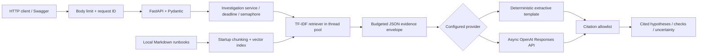

# Architecture and design notes

## Request flow



No tool execution or autonomous loop occurs. Each request is a bounded pipeline. If no evidence survives retrieval and context selection, generation is skipped.

## Modules and ownership

| Module | Responsibility |
| --- | --- |
| `app/main.py` | Factory, lifecycle, dependency wiring, HTTP routes and handlers |
| `app/config.py` | Validated environment and dotenv settings |
| `app/models.py` | Public schemas and constrained provider output |
| `app/middleware.py` | Streamed body cap, body-read timeout, generated request ID, safe errors, request logs |
| `app/services/embedding_service.py` | Sparse lexical vector representation and cosine similarity |
| `app/services/retrieval_service.py` | Validated Markdown ingestion, chunking, ranking, source metadata |
| `app/services/prompt_service.py` | Instructions, evidence selection, explicit context budget |
| `app/services/llm_service.py` | Provider protocol, deterministic template, HTTP integration and retries |
| `app/services/investigation_service.py` | Deadline, capacity control, abstention, citation checks, output assembly |
| `app/demo.py` | Independent HTTP client using packaged synthetic incidents |

## Retrieval baseline

Runbooks are sorted by filename, split at `##` sections, and split again at roughly 1,000 characters if necessary. Long sections are split at a space when practical. There is no overlap or reranker. A chunk has a stable ID such as `database-pool#001` for the current corpus revision. Editing/reordering chunks can change those IDs; the API returns the full excerpt used, and there is no historical citation store.

Tokenization lowercases ASCII letters and numbers and drops a small English stop-word set. Document text includes the runbook title, section heading, and passage. For each term:

```text
tf(term, document) = 1 + ln(term count)
idf(term) = 1 + ln((1 + number of chunks) / (1 + chunks containing term))
weight = tf * idf
embedding = weight vector / L2 norm
similarity = dot product of normalized query and chunk vectors
```

Query terms absent from the fitted vocabulary are ignored. Entirely out-of-vocabulary queries have zero similarity. Ranking is descending similarity, then source ID for stable tie-breaking. The cutoff defaults to 0.12; it is an illustrative configuration choice, not a learned threshold or calibrated confidence. Top-k is capped at five.

Vectors are sparse dictionaries. Startup cost is proportional to corpus terms; per-query scoring scans all chunks. The demo bounds individual files to 100 KB and the corpus to 2,000 chunks. Ingestion is not an untrusted upload API. Larger corpora need different indexing and resource controls.

## Async and resource lifecycle

The app factory accepts explicit settings and an optional provider for tests. FastAPI lifespan loads/indexes the corpus before startup succeeds and owns one reusable `httpx.AsyncClient`. It closes that client at shutdown. The mock provider makes no network calls.

Retrieval and startup file/index work use Starlette's thread pool. Provider I/O uses async HTTPX. An `asyncio.Semaphore` limits active investigations per process; the deadline includes queue wait, retrieval, retries, and synthesis. Cancellation releases the semaphore. Cancellation cannot forcibly stop Python code already running in a worker thread, so a pathological CPU-bound retrieval is not a hard preemption guarantee. The deliberately small corpus reduces that risk. The search endpoint uses the thread pool but not the investigation semaphore.

The request body is buffered only up to the configured byte cap before parsing. A fixed 10-second timeout bounds body reception. Field lengths and list counts further constrain parsed inputs. This is not global admission control: simultaneous waiting clients can still consume resources. Production deployment needs gateway limits.

## Context and grounding

Source records are serialized as JSON and selected in relevance order while their serialized array remains within `MAX_CONTEXT_CHARS`. A source is included whole or omitted; no citation points to a silently truncated passage. An oversized source can be skipped while a smaller later source fits. The same selected evidence is sent to either provider and returned to the client. The budget counts escaped JSON characters, not tokens, and excludes the incident and fixed instructions; input field/body limits separately bound incident size.

The real provider receives trusted system instructions and a user-message JSON envelope containing untrusted incident/runbook data. Structured Outputs specifies the Pydantic-derived schema. The returned JSON is parsed and validated again locally. All hypotheses and checks require at least one source ID; every ID must belong to the selected context. Summary and missing-information text are not claim-level citation checked. Citation membership does not establish entailment or diagnosis correctness.

The mock provider fills a fixed summary, names potential runbook matches, and includes excerpts for an operator to compare. It supplies no learned inference. The complete pipeline is retrieval-augmented templating in mock mode and small LLM RAG in OpenAI mode. The latter integration is transport-mock tested, not live provider certified.

## Failures and retries

Only transport errors, timeouts, HTTP 429, and HTTP 5xx are retried. Two attempts are the default, capped at three; the delay is 0.1 seconds then 0.2 seconds. There is no jitter or `Retry-After` scheduling in this demo. A larger service should implement those and consider a circuit breaker. Retrying generation after a timeout can duplicate upstream work and cost; this implementation offers no exactly-once guarantee.

Authentication/configuration rejection, malformed output, incomplete generation, refusal, and invalid citations fail explicitly. There is no silent mock fallback. Safe error codes are returned without raw provider bodies, incident text, or exception strings. Application request logs omit bodies and user-supplied paths; request IDs are generated internally. Uvicorn's separate operational logs are outside the app JSON formatter.

## Data and trust boundaries

The service does not persist incidents, outputs, or request history. Mock mode stays local. OpenAI mode sends incident content and selected runbook text to the configured model at the fixed OpenAI endpoint, with `store=false`; provider-side handling still applies. Local `.env` is ignored by Git and Docker. There is no automatic PII/secret detector. Use only synthetic or sanitized inputs.

No shell execution, remediation actions, MCP server/client, agent planning, A2A transport, queues, or durable workflow engine are present. These require their own designs and validation before being claimed.
